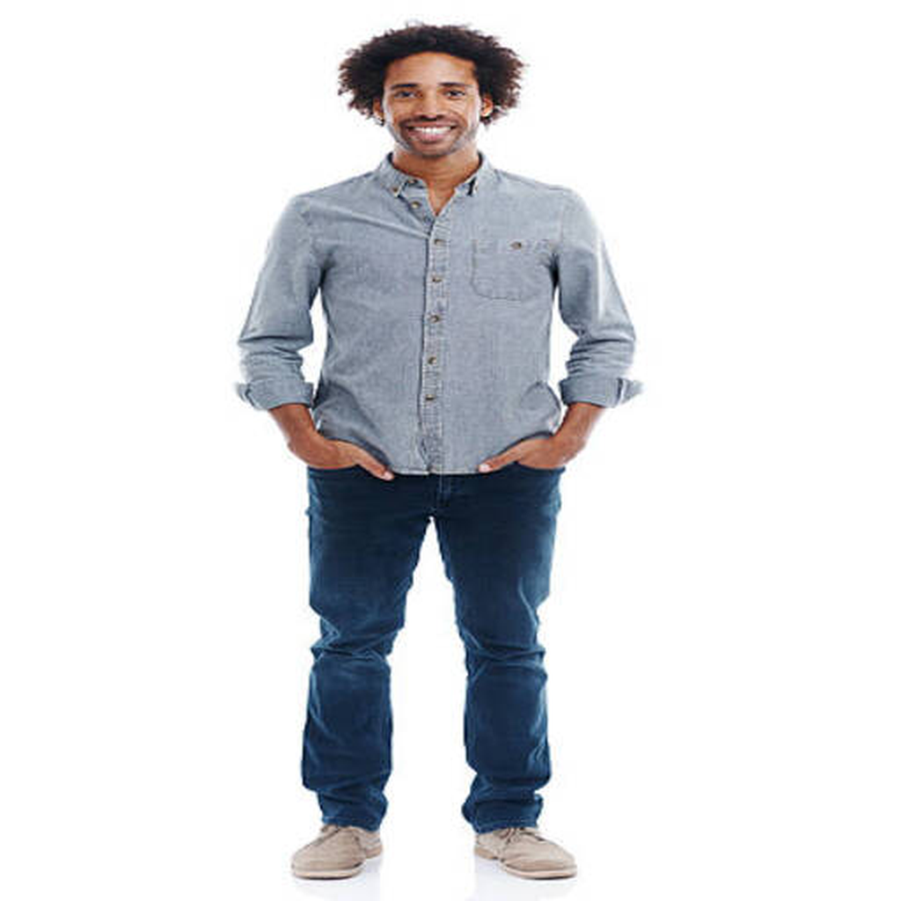
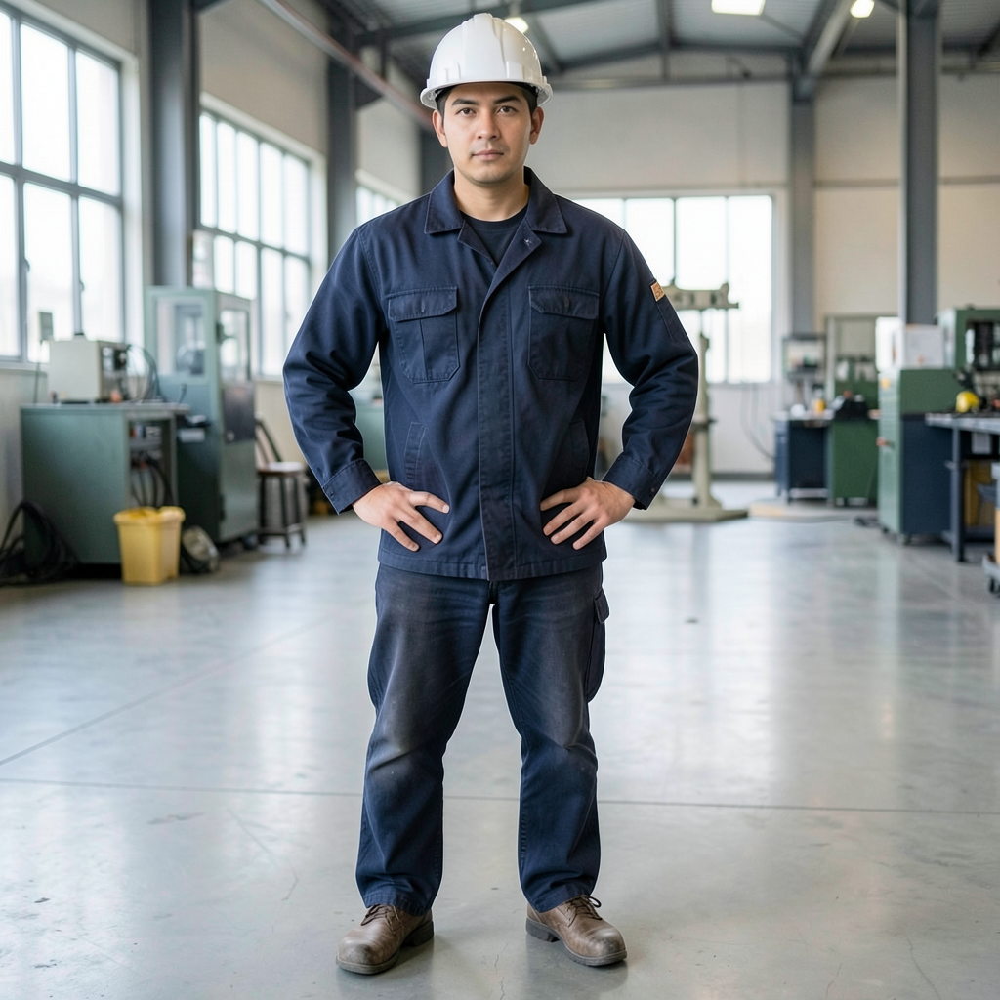
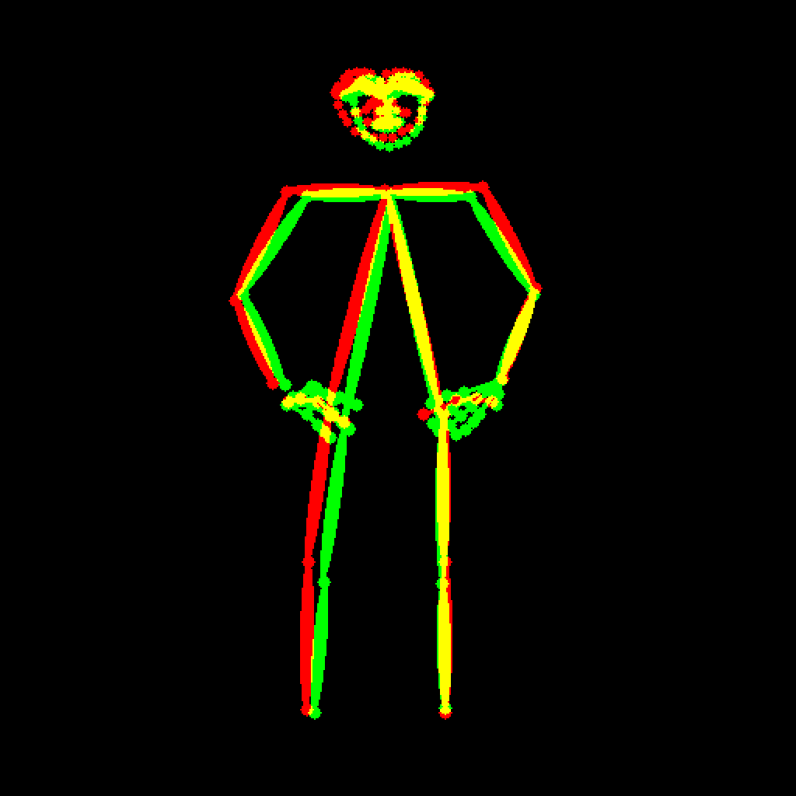
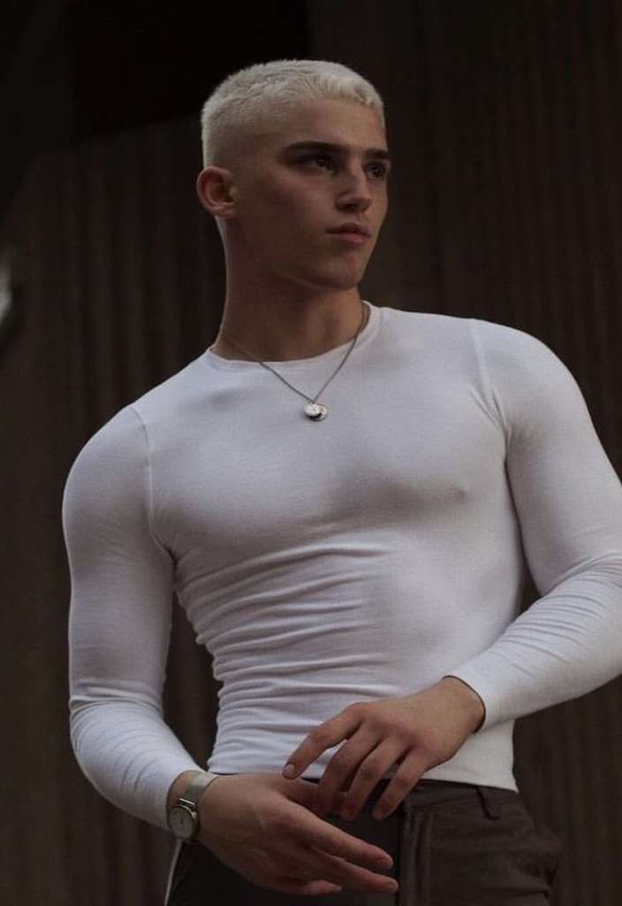
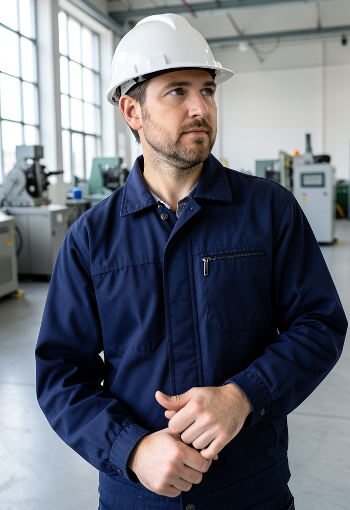
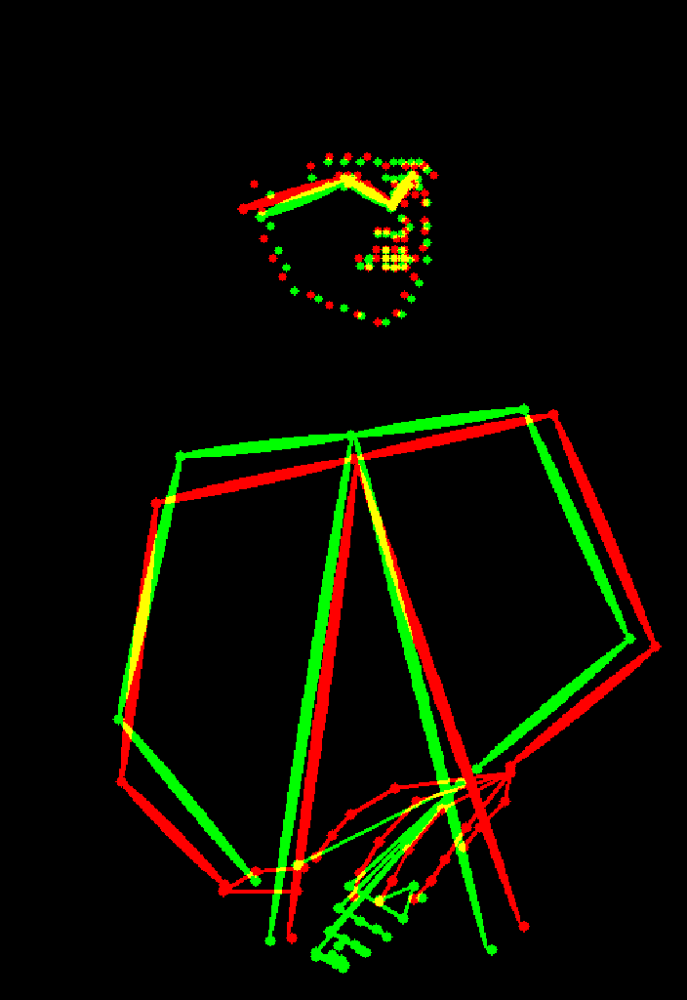

# 원하는 포즈로 이미지 만드는 도구

## 도구 설명
- 참조 사진에서 OpenPose로 관절(뼈대)을 뽑고, 그 뼈대를 FLUX.2-klein 4B에 **참조 이미지(ReferenceLatent)** 로 넣어 프롬프트가 묘사하는 인물을 같은 자세로 그립니다.
- FLUX.2에는 공식 ControlNet이 없어서 FLUX.2의 다중 참조(multi-reference) 기능으로 포즈 조건을 전달합니다.
- 출발점: 교안의 FLUX.2-klein 4B Colab 노트(GGUF Q4 + ComfyUI). 단계 1~4는 같고 단계 5부터 포즈 조건을 더했습니다.

## 사용법
1. `pose_tool.ipynb`를 Colab에서 열고 **런타임 → 런타임 유형 변경 → T4 GPU**를 고릅니다.
2. 셀을 위에서부터 순서대로 실행합니다: GPU 확인 → 설치 → 모델 다운로드 → 서버 실행 → 포즈 추출 → 생성 → 자세 비교 → 조건 실험 → 내려받기.
3. 내 사진을 쓰려면 단계 5의 `UPLOAD = True`로 바꿉니다.
4. 결과는 `samples/`에서 확인합니다.

## 파일
| 경로 | 내용 |
|---|---|
| `pose_tool.ipynb` | Colab 튜토리얼 노트 |
| `samples/pose_XX.png` | 참조로 쓴 사진 |
| `samples/pose_XX_skeleton.png` | OpenPose로 뽑은 뼈대 |
| `samples/output_XX.png` | 같은 자세로 만든 결과 |
| `samples/check_XX_overlay.png` | 참조 뼈대(빨강)와 결과 뼈대(초록) 겹침, 노랑 = 일치 |
| `samples/expA_*`, `expB_*`, `expC_*` | 조건 실험 결과 |
| `prompts.md` | 테스트에 쓴 프롬프트 모음 |

## 설정
- 모델: FLUX.2-klein 4B (GGUF Q4_K_M, 아파치 2.0), 텍스트 인코더 Qwen3-4B, FLUX.2 VAE
- seed 42, 4 steps, cfg 1.0(증류 모델 권장값), euler / simple, 긴 변 1024px

## 테스트 결과
Colab T4에서 실행. 첫 장 84.3초(모델 로드 포함), 이후 한 장 14~26초. 자세한 관찰은 노트 마지막 셀에 있습니다.

| 참조 | 결과 | 겹침 확인 |
|---|---|---|
|  |  |  |
|  |  |  |

- 포즈 1: 전신, 서서 손을 주머니에 넣은 자세 → 프롬프트: 공장 작업자(남색 작업복, 흰 안전모) → 결과: 몸통·다리·팔꿈치 각도는 맞았고, **손은 주머니 속이 아니라 허리를 짚은 모양**으로 바뀌었습니다.
- 포즈 2: 상반신, 고개를 돌리고 두 손을 모은 자세 → 같은 프롬프트 → 결과: 고개 방향과 모은 손은 맞았고, 어깨선과 팔이 조금 아래로 어긋났습니다.
- 같은 포즈에 프롬프트만 바꾸면(요리사·우주인·우비 입은 여성) 자세는 그대로이고 인물·옷·배경이 바뀌었습니다. 수채화 화풍은 나오지 않고 사진처럼 나왔습니다.

## 한계
- **손 같은 세부는 자세보다 프롬프트의 옷·장면에 끌려갑니다.** 뼈대로 줘도, 원본 사진으로 줘도 "주머니에 손"이 "허리에 손"으로 바뀌었습니다.
- **스타일 칸이 포즈 지시 문장과 부딪힙니다.** 앞머리에 "photograph"가 들어 있어 수채화 요청이 무시된 것으로 추정합니다.
- **ControlNet이 아니라 참조 이미지 방식**이라 선을 강제로 따르지 않습니다. 상반신·비스듬한 자세(포즈 2)가 전신·정면 자세(포즈 1)보다 덜 겹쳤습니다.
- 겹침 그림은 가는 선끼리 비교하므로 몇 픽셀만 밀려도 어긋난 것으로 보입니다. 눈으로 함께 확인해야 합니다.
- 참조 사진 2장은 공개 예제 이미지입니다. 다른 용도로 쓸 때는 직접 찍은 사진으로 바꿉니다.

## 회고
- **해 본 것:** 교안의 FLUX.2-klein 4B Colab 노트에 OpenPose 뼈대 추출과 참조 이미지(ReferenceLatent) 조건을 더해, 같은 자세로 다른 인물을 그리는 도구를 만들었습니다. FLUX.2에 공식 ControlNet이 없어서 참조 이미지 방식을 골랐습니다.
- **알게 된 것:** 포즈는 뼈대가, 인물·옷·배경은 프롬프트가 나눠 맡았습니다. 결과를 더 크게 바꾼 쪽은 프롬프트였습니다. 손 위치처럼 프롬프트와 덜 어울리는 세부는 모델이 더 흔한 모양으로 바꿨는데, 5장의 "안 적은 칸은 가장 흔한 값으로 채운다"와 같은 원리로 보였습니다.
- **아쉬운 점:** 포즈 지시 문장에 "photograph"를 넣어 스타일 실험 하나가 제대로 되지 않았습니다. 조건을 붙일 때 다른 칸과 부딪히지 않는지 먼저 봐야 했습니다.
- **느낀 점:** 요즘 카메라로 자신의 모습에 다른 모습을 씌우거나 돌멩이를 고양이로 바꾸는 등의 여러 영상을 봤었는데, 그 기반을 본 것 같아 재미있었습니다.
